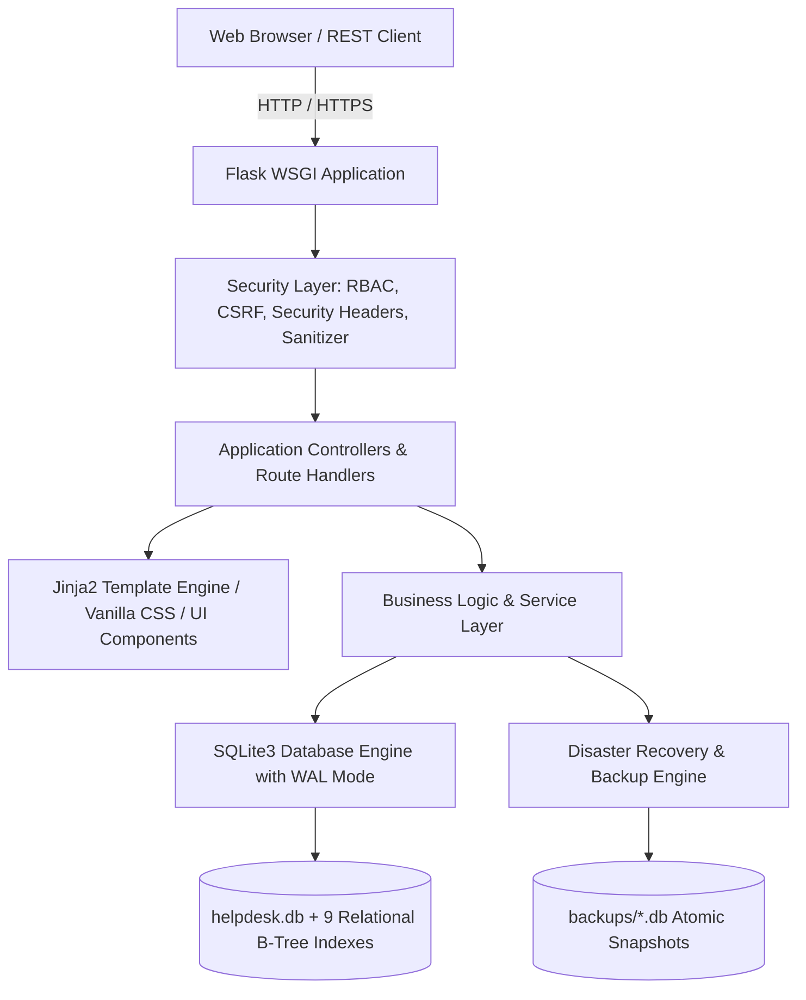
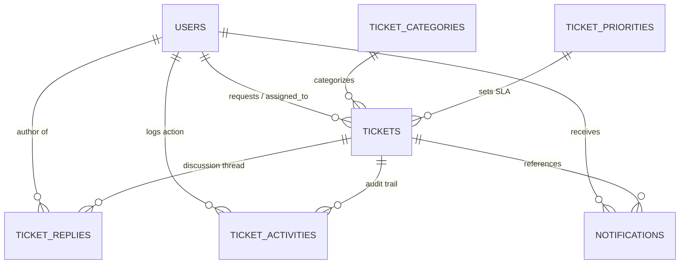

# HelpDesk Support Management System - Comprehensive Project Documentation

**Project Version**: 1.0.0-production  
**Academic Milestone**: Week 9 - Final System Delivery & Capstone Submission  
**Repository**: [https://github.com/naveenkumarkh442004/helpdiskmanagement-system](https://github.com/naveenkumarkh442004/helpdiskmanagement-system)  
**Framework**: Python 3.11+ / Flask / SQLite3 / Jinja2 / Vanilla CSS  

---

## 1. Executive Summary & Project Abstract

The **HelpDesk Support Management System** is an enterprise-grade, multi-tier web application designed to streamline customer support, service request workflows, SLA incident management, team collaboration, and operational intelligence. 

Traditional IT support operations often suffer from untracked email requests, missing audit trails, unenforced SLA turnarounds, unbalanced staff queues, and opaque reporting. This system resolves these challenges by providing:
- **Role-Based Portals**: Dedicated interfaces for End-Users (Clients), Support Engineers (Agents), and System Administrators.
- **Service Desk & Ticket Lifecycle**: Comprehensive ticket intake with attachments, priority categorization, thread discussions, internal notes, and multi-tier escalation paths.
- **SLA & Policy Enforcement**: Tier-based response SLAs (e.g., 2h Critical, 8h High, 24h Medium, 72h Low) with automatic overdue detection.
- **Administrator Control Center**: Account management, role updates, agent workload balancing, and category/priority management.
- **Executive Analytics & Reporting**: Real-time MTTR (Mean Time to Resolution) tracking, monthly volume trends, agent scorecards, and multi-format CSV exports.
- **Production Hardening**: SQLite Write-Ahead Logging (WAL), 9 relational indexes, atomic online disaster recovery backups, and HTTP security response headers.

---

## 2. System Architecture & Technology Stack

The application follows the **Model-View-Controller / Model-View-Template (MVC/MVT)** architectural paradigm:



### Component Breakdown
| Layer | Technologies Used | Key Responsibilities |
| :--- | :--- | :--- |
| **Presentation (Frontend)** | HTML5, Vanilla CSS, Jinja2, FontAwesome 6 | Responsive layouts, CSS variable tokens, glassmorphism banners, modal dialogs, CSS bar charts |
| **Application (Backend)** | Python 3, Flask 3.1+, Werkzeug 3.1+ | Route handling, authentication, authorization decorators, file upload validation, REST APIs |
| **Data (Persistence)** | SQLite3 (WAL Mode, Foreign Keys, 9 Indexes) | ACID compliance, point-in-time online backups, fast analytical aggregation |
| **Web Server / Gateway** | Gunicorn / Waitress / WSGI | Multi-threaded / multi-worker production HTTP request processing |
| **Containerization** | Docker, Docker-Compose | Containerized isolated runtime with volume mounts for uploads, database, and backups |

---

## 3. Database Schema & Data Dictionary

The persistence layer consists of **7 normalized relational tables** engineered for referential integrity and zero data loss.



### Table Definitions

#### `users`
| Column | Type | Constraints | Description |
| :--- | :--- | :--- | :--- |
| `id` | INTEGER | PRIMARY KEY AUTOINCREMENT | Unique user identifier |
| `name` | TEXT | NOT NULL | User's full name |
| `email` | TEXT | NOT NULL | User's email address |
| `username` | TEXT | UNIQUE NOT NULL | Unique login handle |
| `password` | TEXT | NOT NULL | Hashed password (Werkzeug scrypt/pbkdf2) |
| `role` | TEXT | NOT NULL DEFAULT 'User' | Security role: `User`, `Support`, `Admin` |
| `status` | TEXT | NOT NULL DEFAULT 'Active' | Account state: `Active`, `Suspended` |
| `department` | TEXT | DEFAULT 'General' | Assigned organizational department |
| `created_at` | TIMESTAMP | DEFAULT CURRENT_TIMESTAMP | Account creation timestamp |

#### `ticket_categories`
| Column | Type | Constraints | Description |
| :--- | :--- | :--- | :--- |
| `id` | INTEGER | PRIMARY KEY AUTOINCREMENT | Unique category identifier |
| `name` | TEXT | UNIQUE NOT NULL | Category name (e.g., Software Problem) |
| `description` | TEXT | - | Detailed description of scope |
| `color` | TEXT | DEFAULT '#4f46e5' | Hex color badge code |
| `icon` | TEXT | DEFAULT 'fa-ticket' | FontAwesome icon identifier |
| `is_active` | INTEGER | DEFAULT 1 | Active state (1=Active, 0=Inactive) |
| `created_at` | TIMESTAMP | DEFAULT CURRENT_TIMESTAMP | Creation timestamp |

#### `ticket_priorities`
| Column | Type | Constraints | Description |
| :--- | :--- | :--- | :--- |
| `id` | INTEGER | PRIMARY KEY AUTOINCREMENT | Unique priority identifier |
| `name` | TEXT | UNIQUE NOT NULL | Tier name: `Critical`, `High`, `Medium`, `Low` |
| `level` | INTEGER | UNIQUE NOT NULL | Severity hierarchy level (1=Highest) |
| `color` | TEXT | NOT NULL | Hex color badge code |
| `sla_response_hours` | INTEGER | DEFAULT 24 | Target turnaround time in hours |
| `description` | TEXT | - | Severity policy definition |
| `is_active` | INTEGER | DEFAULT 1 | Active toggle |
| `created_at` | TIMESTAMP | DEFAULT CURRENT_TIMESTAMP | Creation timestamp |

#### `tickets`
| Column | Type | Constraints | Description |
| :--- | :--- | :--- | :--- |
| `id` | INTEGER | PRIMARY KEY AUTOINCREMENT | Ticket reference number |
| `username` | TEXT | NOT NULL | Requester's username |
| `category` | TEXT | NOT NULL | Associated issue category |
| `priority` | TEXT | NOT NULL | Assigned priority tier |
| `subject` | TEXT | NOT NULL | Short issue summary |
| `description` | TEXT | NOT NULL | Full problem explanation |
| `attachment` | TEXT | - | Stored sanitized filename on disk |
| `attachment_name` | TEXT | - | Original client-side filename |
| `status` | TEXT | NOT NULL DEFAULT 'Open' | `Open`, `In Progress`, `Pending`, `Resolved`, `Closed` |
| `assigned_to` | TEXT | - | Username of assigned support engineer |
| `resolved_at` | TIMESTAMP | - | Timestamp when ticket transitioned to Resolved |
| `closed_at` | TIMESTAMP | - | Timestamp when ticket was archived/closed |
| `is_escalated` | INTEGER | DEFAULT 0 | Escalation flag (1=Escalated, 0=Normal) |
| `escalation_level` | TEXT | DEFAULT 'None' | Tier 1, Tier 2, Tier 3, Leadership |
| `escalation_reason` | TEXT | - | Reason provided during escalation trigger |
| `escalated_by` | TEXT | - | Username who initiated escalation |
| `escalated_at` | TIMESTAMP | - | Timestamp when escalated |
| `created_at` | TIMESTAMP | DEFAULT CURRENT_TIMESTAMP | Ticket submission time |
| `updated_at` | TIMESTAMP | DEFAULT CURRENT_TIMESTAMP | Last modification time |

#### `ticket_replies`
| Column | Type | Constraints | Description |
| :--- | :--- | :--- | :--- |
| `id` | INTEGER | PRIMARY KEY AUTOINCREMENT | Reply identifier |
| `ticket_id` | INTEGER | FOREIGN KEY REFERENCES tickets(id) | Associated ticket |
| `username` | TEXT | NOT NULL | Author username |
| `role` | TEXT | NOT NULL DEFAULT 'User' | Role of commenter |
| `message` | TEXT | NOT NULL | Message body |
| `is_internal` | INTEGER | DEFAULT 0 | Flag for internal staff notes (1=Internal note) |
| `attachment` | TEXT | - | Stored attachment filename |
| `attachment_name` | TEXT | - | Original attachment name |
| `created_at` | TIMESTAMP | DEFAULT CURRENT_TIMESTAMP | Submission timestamp |

#### `ticket_activities` (Audit Trail)
| Column | Type | Constraints | Description |
| :--- | :--- | :--- | :--- |
| `id` | INTEGER | PRIMARY KEY AUTOINCREMENT | Audit log record ID |
| `ticket_id` | INTEGER | NOT NULL | Related ticket ID |
| `username` | TEXT | NOT NULL | User who triggered the event |
| `activity_type` | TEXT | NOT NULL | `STATUS_CHANGE`, `ASSIGNMENT`, `ESCALATION`, etc. |
| `old_value` | TEXT | - | Previous value |
| `new_value` | TEXT | - | New updated value |
| `message` | TEXT | - | Human-readable audit narrative |
| `created_at` | TIMESTAMP | DEFAULT CURRENT_TIMESTAMP | Audit log timestamp |

#### `notifications`
| Column | Type | Constraints | Description |
| :--- | :--- | :--- | :--- |
| `id` | INTEGER | PRIMARY KEY AUTOINCREMENT | Notification identifier |
| `username` | TEXT | NOT NULL | Recipient username |
| `ticket_id` | INTEGER | - | Referenced ticket ID |
| `sender` | TEXT | - | Originating actor username |
| `title` | TEXT | NOT NULL | Notification title header |
| `message` | TEXT | NOT NULL | Notification text summary |
| `link` | TEXT | NOT NULL | Target URL link |
| `is_read` | INTEGER | DEFAULT 0 | Read receipt status (0=Unread, 1=Read) |
| `created_at` | TIMESTAMP | DEFAULT CURRENT_TIMESTAMP | Notification timestamp |

---

## 4. Weekly Milestone Progression (Weeks 1 to 9)

- **Week 1 - Foundation & Authentication**: Database schema setup, password hashing with Werkzeug, secure user registration, session management, and login portals.
- **Week 2 - Ticket Lifecycle Management**: Ticket creation, secure attachment handling (PDF, images, office docs), dynamic filtering, keyword search, and priority sorting.
- **Week 3 - Discussion Threads & Notifications**: Ticket discussion replies, internal staff-only notes, in-app notification center with real-time dropdown badge alerts.
- **Week 4 - SLA Policies & Multi-Tier Escalations**: SLA configuration by priority, automated escalation routing across Tiers 1-3 and Leadership, audit logging.
- **Week 5 - Support History & Operations Queues**: Comprehensive audit trail portal, event filtering, CSV ticket exports, and Support Dashboard queue views.
- **Week 6 - Administrator Control Center**: User/staff account administration, role assignment, account status toggling, agent workload rebalancing, and category/priority management.
- **Week 7 - Reports & Operations Analytics**: Executive reporting engine, MTTR turnaround calculations, category distribution, agent performance scorecards, pending ticket aging analysis, and monthly volume trends.
- **Week 8 - System Hardening, Security & Disaster Recovery**: Security response headers, session cookie protection, SQLite WAL optimization, 9 performance indexes, point-in-time online backups, and custom error pages (404, 403, 413, 500).
- **Week 9 - Final Delivery, User Manual & Production Deployment**: End-to-end testing across 24 test cases, comprehensive project documentation, user manuals, presentation deck, Dockerization, and cloud deployment configs.

---

## 5. Security & Quality Assurance Verification

The system includes an automated test suite ([test_suite.py](file:///c:/Users/user/OneDrive/Desktop/HelpDesk_system/test_suite.py)) validating **24 end-to-end integration test scenarios**:

```text
=== ALL COMPREHENSIVE HELPDESK TEST CASES PASSED SUCCESSFULLY ===
[PASS] Test 1: Ticket Creation with various categories & priorities.
[PASS] Test 2: Search, Multi-Filter & Priority-Weighted Sorting Queries.
[PASS] Test 3: Escalation Workflow (Trigger, Route, Priority Bump).
[PASS] Test 4: Ticket Metadata Quick Update Endpoint.
[PASS] Test 5: De-escalation Workflow.
[PASS] Test 6: Support History & Audit Trail Portal & API.
[PASS] Test 7: CSV Exports (/tickets/export, /support-history/export).
[PASS] Test 8: Dashboard Escalation Queues & Activity Feeds.
[PASS] Test 9: Admin User Management (Create, Edit, Toggle Status, Password Reset).
[PASS] Test 10: Category Management (Create, Update, Toggle Status, Delete).
[PASS] Test 11: Priority & SLA Policy Management.
[PASS] Test 12: Support Agent Workload Balancing Console.
[PASS] Test 13: Bulk Operations Console (Bulk Status, Priority, Reassignment).
[PASS] Test 14: Help Desk Operations Executive Report CSV Export.
[PASS] Test 15: Reports & Analytics Portal with Timeframe Filters.
[PASS] Test 16: JSON Analytics REST API (/api/reports/stats).
[PASS] Test 17: Dedicated CSV Reports (Summary, Categories, Agents, Monthly).
[PASS] Test 18: Pending Tickets & Aging Backlog Analysis.
[PASS] Test 19: Security Response Headers (nosniff, SAMEORIGIN, XSS, Referrer).
[PASS] Test 20: Performance Optimization (SQLite WAL mode and 9 active indexes).
[PASS] Test 21: Disaster Recovery Online Backup Engine & RBAC.
[PASS] Test 22: Custom Error Handlers (404, 403, 413, 500).
[PASS] Test 23: Data Validation & Secure File Upload Whitelist.
[PASS] Test 24: System Diagnostics & Health Check API (/api/health).
```
